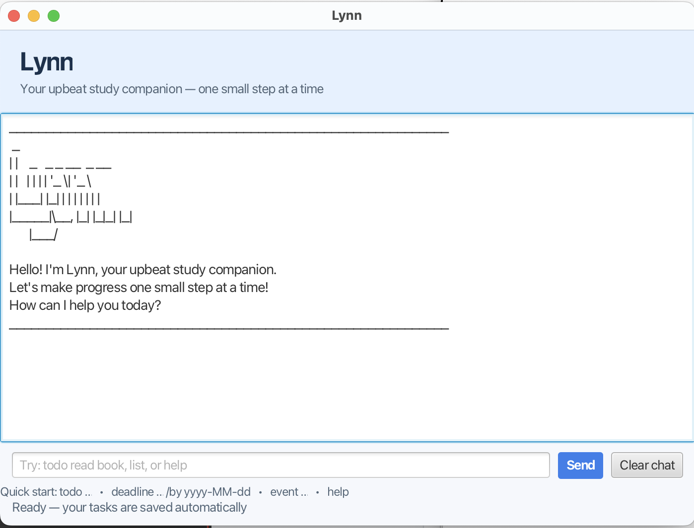

# Lynn User Guide



Lynn is an upbeat study companion that helps you keep track of to-do items,
deadlines, and events. Your task list is saved automatically, so it is still
available the next time you start Lynn.

## Getting started

In the graphical interface, type a command in the input box and press **Enter**
or select **Send**. Select **Clear chat** to clear only the visible conversation;
your saved tasks are not deleted.

You can also run Lynn from a terminal with:

```text
java -jar lynn.jar
```

Enter `help` at any time to see the command list.

## Adding tasks

### To-do

Adds a task without a date or time.

```text
todo <description>
```

Example:

```text
todo read chapter 4
```

### Deadline

Adds a task that is due on a specific date. Dates must use `yyyy-MM-dd`.

```text
deadline <description> /by <yyyy-MM-dd>
```

Example:

```text
deadline submit report /by 2026-10-15
```

### Event

Adds a task with a start and end time. Lynn keeps the time text as entered so
you can use formats such as `Mon 2pm` or `Friday evening`.

```text
event <description> /from <start> /to <end>
```

Example:

```text
event team meeting /from Mon 2pm /to 4pm
```

## Managing tasks

### List tasks

Displays every task in the order it was added.

```text
list
```

### Find tasks

Searches task descriptions without regard to letter case.

```text
find <keyword>
```

Example:

```text
find report
```

### Mark a task as done

Use the task number shown by `list`.

```text
mark <number>
```

Example:

```text
mark 1
```

Use `unmark <number>` to mark it as incomplete again.

### Delete a task

Removes the task with the specified number.

```text
delete <number>
```

Example:

```text
delete 1
```

## Other commands

```text
help    - show the command reference
bye     - exit Lynn
```

## Error handling

Lynn gives a helpful message when a command is incomplete, a task number is
invalid, a deadline date is malformed, or a search keyword is empty. Command
keywords and the `/BY`, `/FROM`, and `/TO` markers are case-insensitive, and
extra spaces around command parts are accepted.

If the `data` folder or `data/lynn.txt` file is missing, Lynn creates it
automatically on startup. Saved task data is stored relative to the folder from
which Lynn is launched.
